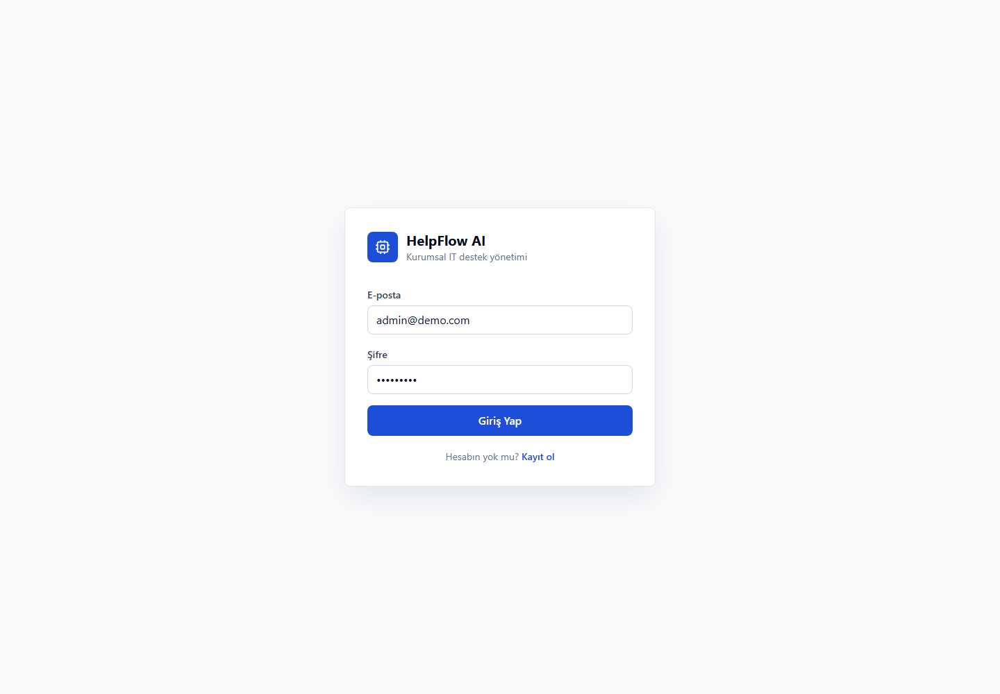

# HelpFlow AI

**AI-assisted IT help desk that routes each support request to the right team, with a priority, as soon as it is submitted.**

In many organisations an IT coordinator reads every incoming ticket by hand and forwards it to the printer team, the network team, the software team and so on. HelpFlow AI automates that first step: an employee describes the problem in plain language, and the system suggests a category, the responsible support unit, a priority, likely causes and the questions IT should ask next. The workflow is modelled on the IT department of a Turkish municipality, so the UI and sample data are in Turkish.

**Live demo:** _add your deployed URL here_ · one-click demo login on the sign-in page (Admin / Employee / IT Staff)

<!-- Add screenshots after deploying: employee ticket form, AI analysis panel, admin dashboard -->
<p>
  
</p>

## How triage works

1. **OpenAI path** (when `OPENAI_API_KEY` is set): the ticket and the organisation's category → support unit mappings are sent to the model, which must return JSON. The response is validated with a Zod schema before it is saved.
2. **Rule-based fallback** (no key, API error, or invalid JSON): `backend/src/services/triageRules.ts` scores Turkish/English keywords per category, weighting the title higher and multi-word phrases higher, and assigns priority from urgency words. The app keeps working without any API key instead of returning an empty analysis.

## Evaluation

`npm run eval:triage` (in `backend/`) checks category accuracy on 60 hand-labelled, synthetic tickets written in everyday employee language:

| Method | Development set (40) | Held-out set (20) |
| --- | --- | --- |
| Rule-based fallback | 92.5% | **70.0%** |
| OpenAI (`npm run eval:triage -- --ai`) | _run with your key_ | _run with your key_ |

The development set was used while writing the keyword rules, so its score is optimistic; the held-out set was written after the rules were frozen and is the realistic number. Keyword rules miss tickets that describe a problem without its usual words (e.g. "pop-up windows keep opening" → security), which is exactly where the LLM path is meant to help. These are synthetic tickets, not production data.

## Stack

- Frontend: React, TypeScript, Vite, Tailwind CSS, React Router, Axios, React Hook Form, Zod, Recharts
- Backend: Node.js, Express.js, TypeScript, Prisma ORM, PostgreSQL, JWT, bcrypt, OpenAI API
- Deployment target: Vercel frontend, Render/Railway backend, Neon/Supabase PostgreSQL

## Project Structure

```text
helpflow-ai/
  frontend/
  backend/
  README.md
```

## Quick Start

```bash
npm install
cp backend/.env.example backend/.env
cp frontend/.env.example frontend/.env
npm run prisma:generate
npm run seed
npm run dev:backend
npm run dev:frontend
```

Set `DATABASE_URL`, `JWT_SECRET`, and optionally `OPENAI_API_KEY` in `backend/.env`.

## Demo Users

- `admin@demo.com` / `Admin123!` / ADMIN
- `employee@demo.com` / `Employee123!` / EMPLOYEE
- `printer.it@demo.com` / `Staff123!` / IT_STAFF
- `network.it@demo.com` / `Staff123!` / IT_STAFF
- `camera.it@demo.com` / `Staff123!` / IT_STAFF

## Core Capabilities

- JWT authentication and role-based authorization
- Employee, IT Staff, and Admin dashboards
- Ticket CRUD, assignment, transfer, status lifecycle, messages, internal notes
- Department, support unit, and category management
- Ticket routing through `Ticket -> Category -> Support Unit`
- AI ticket analysis stored in `ticket_ai_analysis`
- Dashboard and report endpoints for category, support unit, department, and priority metrics

## Backend Scripts

```bash
cd backend
npm run dev
npm run build
npm run prisma:generate
npm run prisma:migrate
npm run seed
npm run eval:triage
```

## Frontend Scripts

```bash
cd frontend
npm run dev
npm run build
npm run preview
```

## Production Deployment With Live Database

### Vercel + Prisma Postgres Database

For a Vercel-first deployment, create a Postgres database from Vercel Marketplace. Prisma Postgres and Neon both work. When the database is connected to the Vercel project, Vercel injects `DATABASE_URL` into the project environment.

Backend expects this variable:

```bash
DATABASE_URL="postgres://..."
```

Run migrations and seed data before first use:

```bash
cd backend
npm run prisma:deploy
npm run seed
```

For a public portfolio demo, set `SEED_DEMO_USERS=true` so the one-click demo accounts on the sign-in page exist. For a real deployment, use these production seed variables so only your real admin account is created:

```bash
SEED_DEMO_USERS=false
SEED_ADMIN_EMAIL="you@example.com"
SEED_ADMIN_PASSWORD="use-a-strong-password"
```

### Backend on Vercel

The backend can run as a Vercel Serverless API from the `backend` folder.

Vercel project settings:

- Root Directory: `backend`
- Build Command: `npm run vercel-build`
- Install Command: `npm install`
- Output Directory: leave empty

Required environment variables:

- `DATABASE_URL`
- `JWT_SECRET`
- `JWT_EXPIRES_IN=7d`
- `FRONTEND_URL=https://your-frontend-domain.vercel.app`
- `CORS_ORIGINS=https://your-frontend-domain.vercel.app`
- `OPENAI_API_KEY`
- `OPENAI_MODEL=gpt-4o-mini`
- `SEED_DEMO_USERS=false`
- `SEED_ADMIN_EMAIL`
- `SEED_ADMIN_PASSWORD`

After the first backend deployment, run:

```bash
npm run seed
```

This creates departments, support units, categories, and the initial admin user.

### Single Vercel Project With Services

If Vercel detects this repository as a multi-service project, keep the Vercel Framework Preset set to `Services`. The root `vercel.json` defines:

- `frontend` at `/`
- `backend` at `/api`

For this mode, set frontend API URL to:

```bash
VITE_API_URL=/api
```

### Backend on Render

This repository includes `render.yaml` for a Render web service.

Required environment variables:

- `NODE_ENV=production`
- `DATABASE_URL`
- `JWT_SECRET`
- `JWT_EXPIRES_IN=7d`
- `FRONTEND_URL=https://your-vercel-domain.vercel.app`
- `CORS_ORIGINS=https://your-vercel-domain.vercel.app`
- `OPENAI_API_KEY`
- `OPENAI_MODEL=gpt-4o-mini`
- `SEED_DEMO_USERS=false`
- `SEED_ADMIN_EMAIL=your-admin-email`
- `SEED_ADMIN_PASSWORD=your-strong-admin-password`

Build command:

```bash
npm install && npm run prisma:generate && npm run build
```

First deploy database setup:

```bash
npm run prisma:deploy
npm run seed
```

Start command:

```bash
npm run start
```

### Frontend on Vercel

Set the project root to `frontend`.

Required environment variable:

- `VITE_API_URL=https://your-backend-domain.vercel.app/api`

Build command:

```bash
npm run build
```

Output directory:

```bash
dist
```

`frontend/vercel.json` is included so React Router routes work after refresh.
